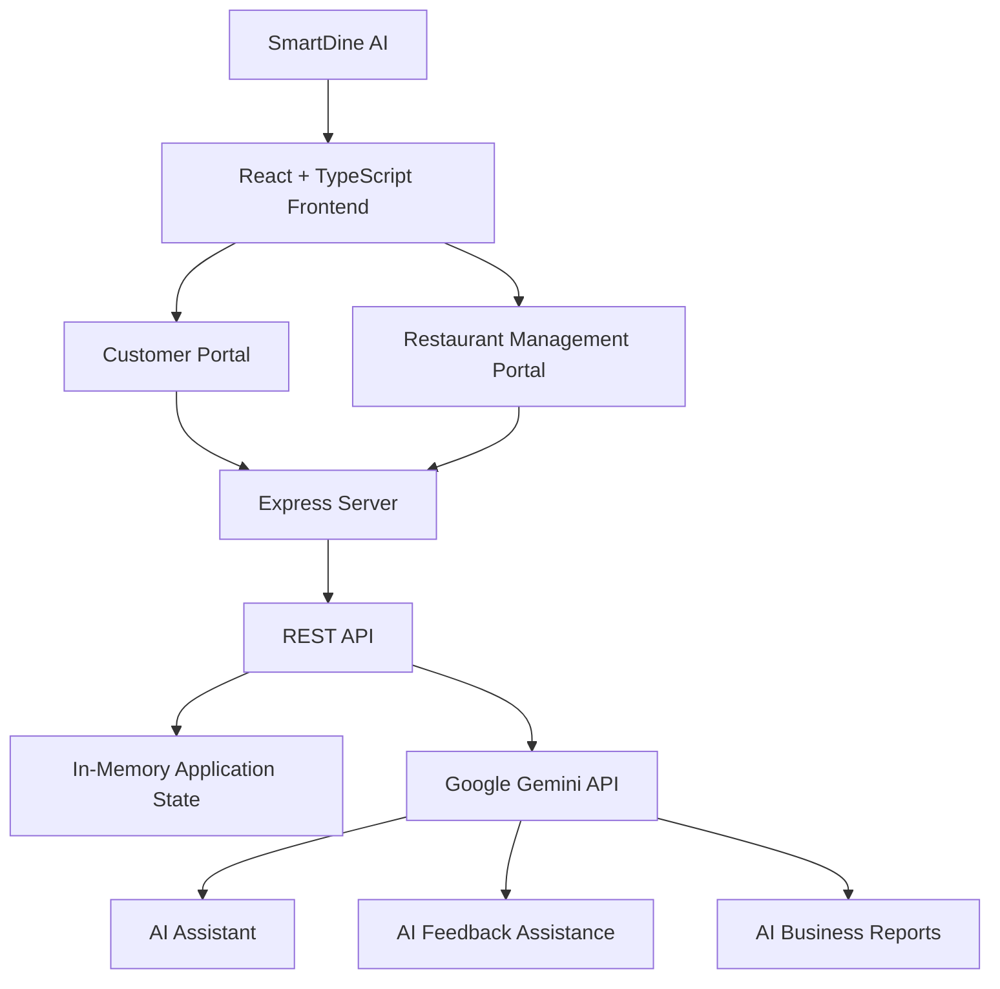
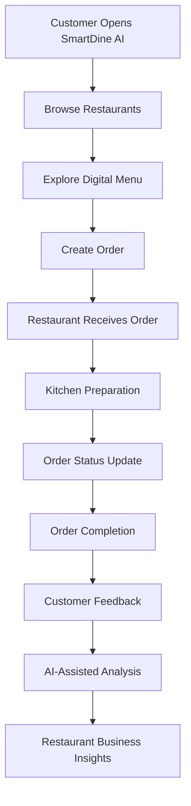

 <div align="center">


# 🍽️ SmartDine AI

### AI-Powered Restaurant Management Platform

**Good Food. Great Experience. Smarter Restaurant Operations.**

A modern full-stack restaurant management platform connecting customers, restaurant teams, kitchen operations, and AI-powered business intelligence through one unified digital ecosystem.

<p>
  
  
  
  
  
  
</p>

<p>
  <a href="#-features">Features</a> •
  <a href="#-technology-stack">Tech Stack</a> •
  <a href="#-architecture">Architecture</a> •
  <a href="#-installation">Installation</a> •
  <a href="#-roadmap">Roadmap</a>
</p>

</div>

---

## 🖥️ Platform Preview

<div align="center">

<!-- Add your customer portal screenshot to docs/screenshots/ -->


**Customer Portal — Premium Dark UI with Orange Accents**

</div>

> To display your screenshot, create `docs/screenshots/` in your repository and add your actual customer portal image as `customer-portal.png`.

---

## 🧡 About the Project

**SmartDine AI** is an intelligent restaurant management platform designed to transform traditional restaurant operations into a connected digital experience.

The platform brings customer-facing food services and restaurant operational workflows together through a unified application.

Customers can discover restaurants, explore digital menus, place orders, reserve tables, manage their profiles, and interact with an AI assistant.

Restaurant teams can manage orders, reservations, kitchen operations, menus, inventory, staff, delivery workflows, and business reports through a centralized management dashboard.

By integrating artificial intelligence and automation capabilities, SmartDine AI aims to improve restaurant efficiency, simplify daily operations, and create better customer experiences.

### 🎯 Project Vision

| Pillar | Description |
|---|---|
| 👤 Customer Experience | Simplified restaurant discovery, online ordering, reservations and engagement |
| 🏢 Restaurant Management | Centralized management of orders, menus, kitchen, inventory and staff |
| 🤖 Artificial Intelligence | Intelligent assistance, feedback analysis and business insights |
| 📊 Business Intelligence | Operational reporting and restaurant performance visualization |
| ⚡ Automation | Future integration with WhatsApp, Pabbly and email notifications |

---

## 📊 Platform Overview

<div align="center">

| 🧑‍💻 Customer Portal | 🏢 Restaurant Portal |
|:---:|:---:|
| Food Discovery & Ordering | Restaurant Operations |
| Table Reservations | Kitchen Management |
| Customer Engagement | Inventory & Staff |
| Loyalty & Rewards | Reports & Analytics |

| 🤖 AI-Powered | ⚡ Full Stack |
|:---:|:---:|
| Google Gemini Integration | React + Express |
| AI Assistant | TypeScript |
| AI Business Reports | Modern Web Architecture |

</div>

---

# ✨ Features

## 👤 01. Customer Portal

A modern food discovery and ordering experience designed around customer convenience.

<details open>
<summary><strong>🍽️ Restaurant Discovery & Digital Menu</strong></summary>

- Explore restaurants.
- Browse restaurant menus.
- Discover food categories.
- Search restaurants and dishes.
- View menu items and food information.
- Explore recommended food items.
- View restaurant information.

</details>

<details>
<summary><strong>🛒 Online Food Ordering</strong></summary>

- Create food orders.
- Add food items to orders.
- Manage order quantities.
- View order information.
- Track order progress.
- Select dine-in, takeaway or delivery workflows.

</details>

<details>
<summary><strong>📅 Table Reservations</strong></summary>

- Create table reservations.
- View reservation details.
- Update reservation information.
- Cancel reservations.
- Manage booking workflows.

</details>

<details>
<summary><strong>❤️ Customer Engagement</strong></summary>

- Favorite restaurants.
- Favorite dishes.
- Loyalty rewards.
- Customer wallet interface.
- Saved addresses.
- Customer support.
- Feedback submission.
- Personal preferences and settings.

</details>

---

## 🏢 02. Restaurant Management Portal

A centralized restaurant operations dashboard for managing daily business activities.

### 📊 Restaurant Dashboard

- Restaurant activity overview.
- Order statistics.
- Operational metrics.
- Reservation information.
- Business performance charts.
- Restaurant activity monitoring.

### 🛒 Order Management

- View incoming orders.
- Create and manage orders.
- Update order status.
- Modify order information.
- Delete orders.
- Assign delivery riders.

### 🍳 Kitchen Management

- Kitchen order queue.
- Cooking workflow.
- Order preparation tracking.
- Completed order management.
- Kitchen activity coordination.

### 🧑‍🍳 Waiter Management

- Waiter notifications.
- Table service requests.
- Service completion updates.
- Restaurant service coordination.

### 🍽️ Menu Management

- Add menu items.
- Update menu information.
- Delete menu items.
- Manage restaurant food offerings.

### 📅 Reservation Management

- View reservations.
- Create reservations.
- Update booking information.
- Cancel reservations.
- Manage reservation workflows.

### 📦 Inventory Management

- Inventory item management.
- Stock updates.
- Stock availability.
- Low-stock monitoring.
- Waste tracking.
- AI-assisted recipe and inventory support.

### 👥 Staff Management

- Add employees.
- Update staff details.
- Remove employees.
- Attendance management.
- Shift information.
- Staff performance information.

### 🚚 Delivery Management

- Delivery order management.
- Rider assignment.
- Delivery workflow management.
- Order status monitoring.

### 📈 Reports & Analytics

- Restaurant activity reports.
- Business metrics.
- Operational analytics.
- AI-generated business reports.

### ⚙️ Restaurant Settings

- Restaurant configuration.
- System preferences.
- Restaurant-related settings.

---

## 🤖 03. AI-Powered Intelligence

SmartDine AI integrates Google's Gemini API to introduce intelligent capabilities into restaurant workflows.

| AI Feature | Description |
|---|---|
| AI Restaurant Assistant | Answers restaurant-related questions |
| AI Feedback Assistance | AI-assisted customer feedback processing |
| AI Business Reports | Generates reports using operational data |
| AI Recipe Assistance | Provides recipe-related suggestions |
| Inventory Assistance | Supports inventory-related queries |

**AI Integration:** Google Gemini API using the official `@google/genai` SDK.

---

## 📲 04. Automation & Notifications

Planned automation capabilities:

- Pabbly Connect integration.
- WhatsApp Cloud API.
- Automated order confirmations.
- Reservation reminders.
- Order status notifications.
- Promotional campaigns.
- Birthday greetings.
- Feedback requests.
- Email notifications.

*These are planned integrations and require implementation and testing before they can be considered operational.*

---

# 🛠️ Technology Stack

<div align="center">

### Frontend Technologies


### Backend Technologies


### AI & Development Tools


</div>

| Layer | Technology | Purpose |
|---|---|---|
| Frontend | React 19 | User interface |
| Language | TypeScript | Type-safe development |
| Build Tool | Vite | Fast development and builds |
| Styling | Tailwind CSS 4 | Responsive UI design |
| Icons | Lucide React | Interface icons |
| Animations | Motion | UI animations |
| Charts | Recharts | Data visualization |
| Backend | Express 4 | REST API and server |
| Runtime | Node.js | Server execution |
| Server Runner | tsx | TypeScript execution |
| AI | Google Gemini | AI-powered features |
| AI SDK | @google/genai | Gemini integration |
| Bundler | esbuild | Production server bundling |

---

# 🏗️ Architecture

SmartDine AI currently uses a unified full-stack architecture.

<div align="center">



</div>

### Architecture Layers

**1. Presentation Layer**
- React components.
- Customer interface.
- Restaurant management interface.
- Dashboard visualizations.
- User interactions.

**2. Application Layer**
- Express server.
- REST API endpoints.
- Order management.
- Reservation operations.
- Menu and inventory workflows.
- Staff management.

**3. AI Layer**
- Google Gemini API.
- AI restaurant assistant.
- Feedback assistance.
- Business report generation.
- Recipe and inventory assistance.

**4. Data Layer**
- Current implementation uses in-memory application state.
- PostgreSQL persistence is planned for a future development phase.

---

# 📂 Project Structure

```text
SmartDine-AI/
│
├── assets/
│   └── Static images and media
│
├── docs/
│   └── screenshots/
│       └── customer-portal.png
│
├── src/
│   ├── components/
│   │   └── Reusable UI components
│   │
│   ├── App.tsx
│   │   └── Main application interface
│   │
│   ├── main.tsx
│   │   └── React entry point
│   │
│   ├── index.css
│   │   └── Global styling
│   │
│   ├── menu_data.ts
│   │   └── Initial menu data
│   │
│   └── types.ts
│       └── Shared TypeScript types
│
├── .env.example
├── .gitignore
├── index.html
├── package.json
├── package-lock.json
├── server.ts
├── tsconfig.json
├── vite.config.ts
└── README.md
```

---

# ⚙️ Installation

Follow these steps to run SmartDine AI locally.

### Prerequisites

| Requirement | Version |
|---|---|
| Node.js | 18 or newer |
| npm | Compatible with installed Node.js |
| Git | Latest stable |
| VS Code | Recommended |
| Google Gemini API Key | Required for AI features |

### 01. Clone Repository

```bash
git clone https://github.com/YOUR_USERNAME/SmartDine-AI.git
```

```bash
cd SmartDine-AI
```

### 02. Install Dependencies

```bash
npm install
```

### 03. Configure Environment

Copy the example environment file.

**Windows PowerShell:**

```powershell
Copy-Item .env.example .env
```

### 04. Add Gemini API Key

Create or edit the `.env` file:

```env
GEMINI_API_KEY=your_gemini_api_key_here
```

Get your API key:

https://aistudio.google.com/apikey

### 05. Start Development Server

```bash
npm run dev
```

Open your browser:

```text
http://localhost:3000
```

---

# 🚀 Available Commands

| Command | Description |
|---|---|
| `npm install` | Install dependencies |
| `npm run dev` | Start development server |
| `npm run lint` | Run TypeScript validation |
| `npm run build` | Build frontend and backend |
| `npm start` | Start production server |
| `npm run clean` | Remove generated build directory (Unix-like shells) |

### Production Build

```bash
npm run build
```

### Start Production Server

```bash
npm start
```

The production build generates the frontend assets and bundles the Express server into `dist/server.cjs`.

---

# 🔌 API Endpoints

The Express server exposes REST APIs under `/api`.

| Method | Endpoint | Description |
|---|---|---|
| GET | `/api/state` | Retrieve application state |
| POST | `/api/orders` | Create order |
| PUT | `/api/orders/:id` | Update order |
| DELETE | `/api/orders/:id` | Delete order |
| POST | `/api/orders/:id/status` | Update order status |
| POST | `/api/orders/:id/assign-rider` | Assign delivery rider |
| POST | `/api/reservations` | Create reservation |
| PUT | `/api/reservations/:id` | Update reservation |
| DELETE | `/api/reservations/:id` | Delete reservation |
| POST | `/api/reservations/:id/cancel` | Cancel reservation |
| POST | `/api/menu` | Add menu item |
| PUT | `/api/menu/:id` | Update menu item |
| DELETE | `/api/menu/:id` | Delete menu item |
| POST | `/api/inventory` | Add inventory item |
| PUT | `/api/inventory/:id` | Update inventory |
| DELETE | `/api/inventory/:id` | Delete inventory |
| POST | `/api/inventory/update` | Update stock |
| POST | `/api/recipes` | Recipe assistance |
| POST | `/api/staff` | Add staff member |
| PUT | `/api/staff/:id` | Update staff member |
| DELETE | `/api/staff/:id` | Delete staff member |
| POST | `/api/staff/attendance` | Update attendance |
| POST | `/api/feedback` | Submit customer feedback |
| POST | `/api/ai/assistant` | AI assistant |
| POST | `/api/ai/business-report` | AI business report |
| POST | `/api/admin/reset-day` | Reset demo data |

Additional service endpoints:

```text
POST   /api/waiter/notifications/:id/serve
POST   /api/bills/:id/pay
PUT    /api/bills/:id
DELETE /api/bills/:id
```

---

# 🔄 Customer-to-Restaurant Workflow



---

# 🗄️ Data Management

### Current Prototype

The current application uses in-memory server state.

This means:

- Application data is maintained in server memory.
- Data resets when the server restarts.
- No persistent database is configured.
- Multiple server instances do not share application state.

### Planned Database Integration

Future PostgreSQL entities:

- Users
- Customers
- Restaurants
- Branches
- Menu Categories
- Menu Items
- Orders
- Order Items
- Reservations
- Tables
- Staff
- Inventory
- Suppliers
- Reviews
- Notifications
- Marketing Campaigns
- AI Conversations
- Audit Logs

---

# 🔐 Security

Security considerations for future production deployment:

- Secure authentication.
- Role-based access control.
- Password hashing.
- API validation.
- Rate limiting.
- Secure environment variables.
- CORS restrictions.
- HTTPS.
- Database security.
- Audit logs.
- Backup and recovery.

**Important:** The current version is a prototype intended for development and demonstration. It is not yet ready to handle real customer or business data.

Never commit `.env` or expose your Gemini API key.

---

# 🛣️ Roadmap

The following roadmap separates existing functionality from planned enhancements.

### Platform Foundation

- [x] React + TypeScript frontend
- [x] Express backend
- [x] Customer portal
- [x] Restaurant operations interface
- [x] Order management workflows
- [x] Reservation workflows
- [x] Menu management
- [x] Inventory workflows
- [x] Staff management
- [x] Gemini AI integration

### Database & Authentication

- [ ] PostgreSQL integration
- [ ] Persistent database storage
- [ ] Secure authentication
- [ ] Role-based access control
- [ ] User and staff account management

### Advanced Restaurant Operations

- [ ] Advanced kitchen display system
- [ ] Multi-branch management
- [ ] Advanced reservation availability
- [ ] Supplier management
- [ ] Advanced inventory forecasting

### AI & Analytics

- [ ] AI food recommendation engine
- [ ] AI sales forecasting
- [ ] AI demand prediction
- [ ] Customer segmentation
- [ ] AI sentiment analysis
- [ ] Advanced business intelligence

### Automation

- [ ] Pabbly Connect integration
- [ ] WhatsApp Cloud API
- [ ] Automated order notifications
- [ ] Reservation reminders
- [ ] Email automation
- [ ] Marketing campaigns

### Deployment

- [ ] GitHub CI/CD
- [ ] Vercel frontend deployment
- [ ] Backend cloud hosting
- [ ] Managed PostgreSQL
- [ ] Automated testing
- [ ] Production monitoring
- [ ] Security testing

---

# 🤝 Contributing

Contributions, ideas, suggestions, and improvements are welcome.

1. Fork the repository.
2. Create a feature branch.
3. Implement your changes.
4. Run TypeScript validation.
5. Test the application.
6. Submit a pull request.

```bash
git checkout -b feature/new-feature

git add .

git commit -m "feat: add new feature"

git push origin feature/new-feature
```

---

# 📄 License

No license has been selected yet. A suitable license will be added when the project is ready for public distribution.

---

<div align="center">

## 🧡 SmartDine AI

### Smart Restaurants. Smarter Operations. Better Experiences.

**Built with React, TypeScript, Express and Google Gemini AI.**


**If you like this project, consider giving it a ⭐**

</div>
