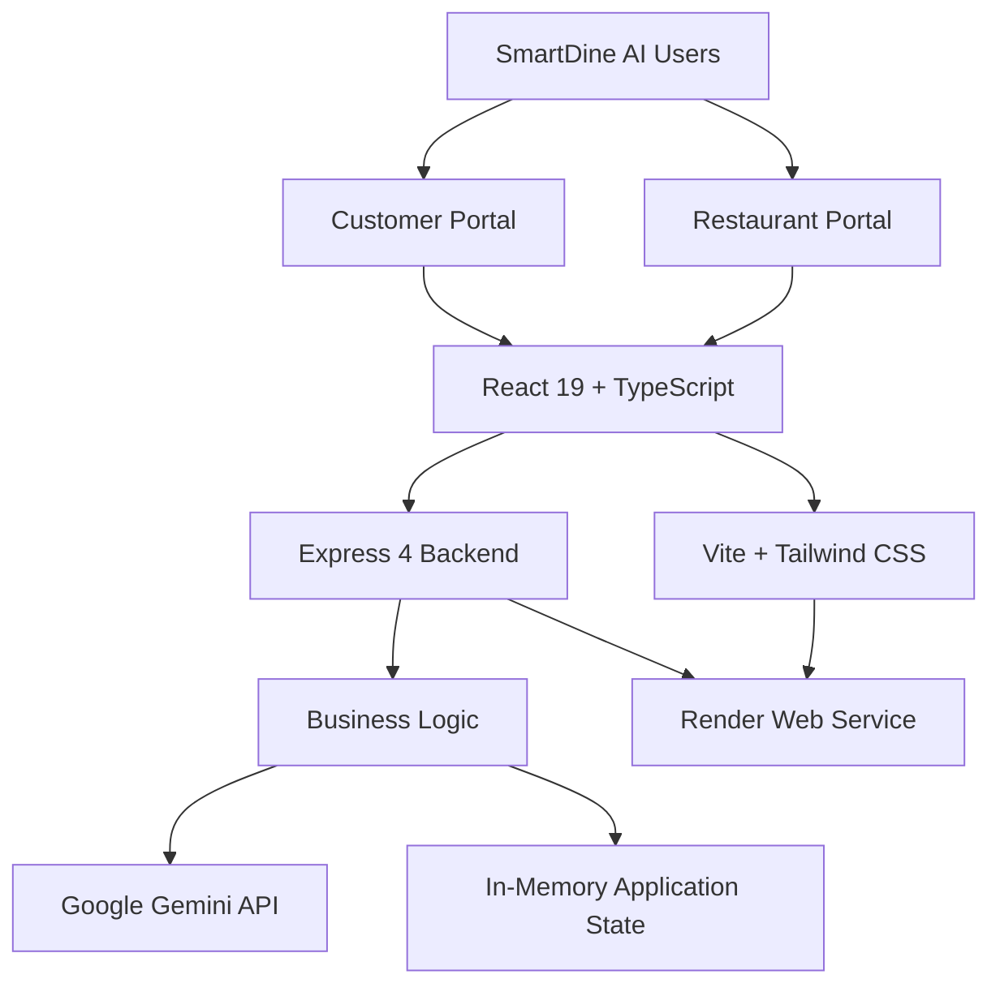
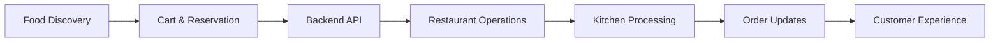

# 🍽️ SmartDine AI

### Intelligent Restaurant Management & AI-Powered Food Ordering Platform

<p align="center">
  <strong>Discover Better. Dine Smarter. Manage Intelligently.</strong>
</p>

<p align="center">
  <a href="https://smartdine-ai-hpi1.onrender.com">
    
  </a>
  <a href="https://github.com/suvinbrettleeroy/SmartDine-AI">
    
  </a>
</p>

<p align="center">
  
  
  
  
  
  
  
</p>

---

## ✨ Overview

**SmartDine AI** is an AI-powered restaurant management and food ordering platform that connects customer dining experiences with restaurant business operations through a unified digital ecosystem.

Built using modern full-stack technologies and Google Gemini AI, it brings restaurant discovery, online ordering, reservations, kitchen operations, inventory management, and business analytics into one application.

| 🛍️ Customer Experience | 🏪 Restaurant Intelligence |
|:---|:---|
| Restaurant Discovery | Business Dashboard |
| Food & Menu Exploration | Order Management |
| Online Food Ordering | Kitchen Operations |
| Table Reservations | Menu Management |
| AI Food Assistant | Inventory & Staff |
| Customer Management | Analytics & AI Assistant |

---

## 🚀 Core Features

### 🛍️ Customer Portal

- Restaurant discovery and digital menu browsing
- Food categories, search and restaurant exploration
- Dish details and favorites
- Shopping cart and order creation
- Dine-in, pickup and delivery ordering workflows
- Order history and status tracking
- Table reservations and cancellation
- Loyalty rewards and wallet interface
- Saved addresses and customer preferences
- Feedback and AI-assisted responses
- Customer support and settings

### 🏪 Restaurant Management Portal

- Centralized business dashboard and operational metrics
- Order management and status updates
- Kitchen and chef workflow management
- Digital waiter notifications and table-service actions
- Billing and payment workflow
- Delivery partner management and rider assignment
- Menu creation, editing and deletion
- Reservation management
- Inventory, stock alerts and waste tracking
- AI-assisted recipe guidance
- Staff, attendance and shift management
- Sales reports and business analytics
- AI-powered business assistant
- AI-generated business reports
- Restaurant and system configuration
- Demonstration data reset functionality

### 🤖 AI & Intelligence

- Google Gemini API integration
- Conversational restaurant assistance
- Customer feedback and AI-assisted responses
- AI-powered recipe and inventory assistance
- Business report generation
- Operational question answering

### ⚡ Automation & Integrations

- Gemini API integration
- Planned Pabbly workflow automation
- Planned WhatsApp notifications
- Planned email automation

---

## 🧠 AI & Machine Learning Roadmap

| Intelligence Module | Application |
|---|---|
| Food Recommendation | Personalized food discovery |
| Customer Analytics | Customer behavior analysis |
| Demand Forecasting | Restaurant demand prediction |
| Sales Prediction | Business forecasting |
| Inventory Intelligence | Stock optimization |
| Customer Segmentation | Customer insights |

*Advanced machine learning capabilities are planned enhancements and are not currently deployed models.*

---

## 🏗️ System Architecture

SmartDine AI uses a combined full-stack architecture in which the Express server handles backend APIs and serves the React application.



### Application Workflow



---

## 🧰 Technology Stack

| Layer | Technologies |
|---|---|
| Frontend | React 19, TypeScript 5 |
| Build Tool | Vite 6 |
| Styling | Tailwind CSS 4 |
| UI & Animation | Lucide React, Motion |
| Visualization | Recharts, Chart.js |
| Backend | Node.js, Express 4 |
| AI Integration | Google Gemini, `@google/genai` |
| Development | VS Code, npm, Git |
| Bundling | Vite, esbuild |
| Version Control | GitHub |
| Deployment | Render |

---

## 🔌 Backend API

The Express backend exposes REST API endpoints for restaurant operations.

### State & Orders

| Method | Endpoint | Description |
|---|---|---|
| GET | `/api/state` | Retrieve application state |
| POST | `/api/orders` | Create an order |
| PUT | `/api/orders/:id` | Update an order |
| DELETE | `/api/orders/:id` | Delete an order |
| POST | `/api/orders/:id/status` | Update order status |
| POST | `/api/orders/:id/assign-rider` | Assign delivery rider |

### Reservations

| Method | Endpoint | Description |
|---|---|---|
| POST | `/api/reservations` | Create reservation |
| PUT | `/api/reservations/:id` | Update reservation |
| DELETE | `/api/reservations/:id` | Delete reservation |
| POST | `/api/reservations/:id/cancel` | Cancel reservation |

### Menu, Inventory & Staff

| Method | Endpoint | Description |
|---|---|---|
| POST | `/api/menu` | Add menu item |
| PUT | `/api/menu/:id` | Update menu item |
| DELETE | `/api/menu/:id` | Delete menu item |
| POST | `/api/inventory` | Add inventory item |
| PUT | `/api/inventory/:id` | Update inventory |
| DELETE | `/api/inventory/:id` | Delete inventory item |
| POST | `/api/inventory/update` | Update stock |
| POST | `/api/recipes` | Generate recipe assistance |
| POST | `/api/staff` | Add staff member |
| PUT | `/api/staff/:id` | Update staff member |
| DELETE | `/api/staff/:id` | Delete staff member |
| POST | `/api/staff/attendance` | Update attendance |

### Restaurant Operations

| Method | Endpoint | Description |
|---|---|---|
| POST | `/api/waiter/notifications/:id/serve` | Mark notification as served |
| POST | `/api/bills/:id/pay` | Process bill payment workflow |
| PUT | `/api/bills/:id` | Update bill |
| DELETE | `/api/bills/:id` | Delete bill |
| POST | `/api/feedback` | Submit customer feedback |
| POST | `/api/admin/reset-day` | Reset demonstration data |

### AI Services

| Method | Endpoint | Description |
|---|---|---|
| POST | `/api/ai/assistant` | AI restaurant assistance |
| POST | `/api/ai/business-report` | Generate AI business report |

*Endpoint reference based on the current project documentation.*

---

## 📁 Project Structure

```text
SmartDine-AI/
│
├── assets/
│
├── src/
│   ├── components/
│   ├── App.tsx
│   ├── main.tsx
│   ├── index.css
│   ├── menu_data.ts
│   └── types.ts
│
├── server.ts
│
├── .env.example
├── .gitignore
├── index.html
├── metadata.json
├── package.json
├── package-lock.json
├── tsconfig.json
├── vite.config.ts
│
└── README.md
```

---

## ⚙️ Getting Started

### Prerequisites

- Node.js 18 or newer
- npm
- Git
- Google Gemini API key for AI-powered features

### 1. Clone Repository

```powershell
git clone https://github.com/suvinbrettleeroy/SmartDine-AI.git

cd SmartDine-AI
```

### 2. Install Dependencies

```powershell
npm install
```

### 3. Configure Environment

Copy the example environment file:

```powershell
Copy-Item .env.example .env
```

Open `.env`:

```powershell
notepad .env
```

Configure your Gemini API key:

```env
GEMINI_API_KEY=your_gemini_api_key_here
```

### 4. Run Development Server

```powershell
npm run dev
```

Open the application:

**http://localhost:3000**

The Express server provides the backend API and Vite development frontend from the same port.

### 5. Production Build

```powershell
npm run build
```

### 6. Start Production Server

```powershell
npm start
```

Open:

**http://localhost:3000**

---

## 📜 Available Commands

| Command | Description |
|---|---|
| `npm install` | Install dependencies |
| `npm run dev` | Start development server |
| `npm run lint` | Run TypeScript validation |
| `npm run build` | Build frontend and production backend |
| `npm start` | Start production application |
| `npm run clean` | Remove production build directory |

---

## ☁️ Deployment

<p align="center">
  
  &nbsp; → &nbsp;
  
</p>

| Configuration | Details |
|---|---|
| Hosting Platform | Render |
| Service Type | Web Service |
| Runtime | Node.js |
| Frontend | React + Vite |
| Backend | Express |
| AI Provider | Google Gemini |
| Deployment Source | GitHub |

### 🚀 Live Application

<p align="center">
  <a href="https://smartdine-ai-hpi1.onrender.com">
    
  </a>
</p>

**Production URL:** https://smartdine-ai-hpi1.onrender.com

---

## 📊 Development Status

| Module | Status |
|---|---|
| Customer Portal | Implemented |
| Restaurant Operations Portal | Implemented |
| React Frontend | Implemented |
| Express Backend | Implemented |
| Order & Reservation APIs | Implemented |
| Menu & Inventory APIs | Implemented |
| Gemini AI Integration | Integrated |
| AI Business Reports | Integrated |
| Render Deployment | Live |
| PostgreSQL Integration | Planned |
| Authentication & RBAC | Planned |
| Advanced ML Models | Planned |
| WhatsApp Automation | Planned |
| Automated Testing | Planned |

---

## 🗄️ Data & Persistence

The current application uses **in-memory server state** for its demonstration workflows.

- Application data is not stored in a persistent database.
- Server restarts restore the initial demonstration state.
- Multiple server instances do not share in-memory data.
- PostgreSQL integration is planned.

This version is intended for development, demonstrations and prototype workflows. It should not be used for real customer, payment or business records without implementing persistent storage and appropriate security controls.

---

## 🔐 Security

- Environment-based configuration
- Server-side Gemini API credentials
- `.env` excluded from source control
- `.env.example` provided for configuration
- Planned secure authentication and authorization
- Planned API validation and rate limiting

**Never commit or expose your Gemini API key.**

---

## 🔮 Development Roadmap

- [x] Customer and restaurant portal foundation
- [x] Full-stack application implementation
- [x] Gemini AI integration
- [x] Initial Render deployment
- [ ] PostgreSQL database integration
- [ ] Secure authentication and role management
- [ ] Advanced AI recommendations
- [ ] Predictive restaurant analytics
- [ ] Pabbly and WhatsApp automation
- [ ] Automated testing and monitoring
- [ ] Production scalability improvements

---

## 👨‍💻 Developer

**Suvin Brettlee Roy B.**

B.Tech — Computer Science & Engineering  
Artificial Intelligence & Machine Learning

[](https://github.com/suvinbrettleeroy)

**Interests:** AI/ML · Generative AI · Full-Stack Development · Data Science · AI Agents · Automation

---

<p align="center">
  <strong>⭐ Star this repository if you find it interesting!</strong>
  <br/><br/>
  
  <br/><br/>
  <sub>Built with ❤️ using React, TypeScript, Node.js, Express & Google Gemini.</sub>
  <br/>
  <sub>© 2026 SmartDine AI · Developed by Suvin Brettlee Roy B.</sub>
</p>
